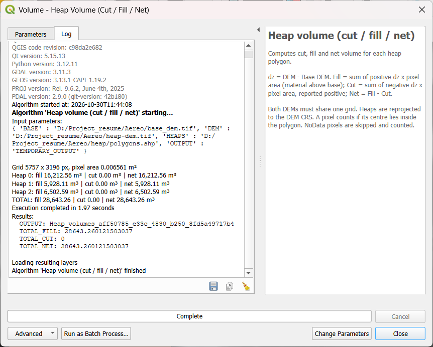

# Heap Volume — QGIS Processing Script

A QGIS Processing script that computes the **cut, fill and net volume** of stockpiles (heaps) between a heap DEM and a base DEM, for one or more heap polygons.

---

## 1. Problem

Given

- A **DEM** of the current surface (raster data)
- A **Base DEM** (raster data)
- **Polygons** outlining the heaps (vector data)

report how much material each heap contains.

## 2. Solution

For every pixel whose **centre** lies inside a heap polygon:

```
dz   = DEM − Base DEM                       (height difference, metres)
Fill = Σ dz   where dz > 0   × pixel area   material ABOVE the base
Cut  = Σ |dz| where dz < 0   × pixel area   space BELOW the base (reported positive)
Net  = Fill − Cut
```

Each pixel is treated as a column of material (pixel area × height difference); the volume is the sum of the columns.

**Processing steps**

1. **Validate inputs** — Checking whether both DEMs in the same projected CRS and on the same pixel grid; otherwise stop with a clear error.
2. **Read rasters as masked arrays** — NoData (and NaN) pixels are excluded from all calculations.
3. **Reproject each heap polygon** to the DEM's CRS.
4. **Rasterize** the polygon onto the DEM grid (pixel-centre rule).
5. **Compute volumes** with `compute_vol()` and write one output row per heap.
6. **Report totals**, NoData counts and warnings in the log.

**Project structure**

```
heap_processing.py   QGIS Processing algorithm: inputs, validation, reprojection, rasterizing, output
core/volume.py       compute_vol() and VolResult — pure NumPy, no QGIS dependency
test/test_vol.py     unit tests for core/volume.py
requirements-dev.txt pinned development dependencies
notebooks/exploration.ipynb   data exploration and an independent cross-check of heap 0 (rasterio + geopandas)
```

## 3. How to use

### Requirements

- **QGIS 3.40** (tested on 3.40.10-Bratislava). QGIS already bundles NumPy and GDAL, so nothing needs to be installed for the tool itself.

### Install

1. Clone or download this repository.
2. In QGIS: **Settings → Options → Processing → Providers → Scripts → Scripts folder(s)** → add the repository folder.
3. Restart QGIS (or reload scripts in the Processing Toolbox).

> The script imports `core/volume.py` from its own folder, so add the **folder** as shown above. *Add Script to Toolbox* copies only the single file and will not find `core/`.

### Run

1. **Processing Toolbox → Scripts → Volume → Heap volume (cut / fill / net)**
2. Set the inputs:
   - **DEM (current surface)** — e.g. `heap-dem.tif`
   - **Base DEM** — e.g. `base_dem.tif`
   - **Heap polygon(s)** — tick **Selected features only** to measure just the heap(s) selected on the map
3. Click **Run**.

### Outputs

- A polygon layer **Heap volumes** (in the DEM's CRS) with one row per heap:

| Field | Meaning |
|---|---|
| `heap_id` | feature id of the input polygon |
| `area_m2` | heap footprint area (m²) |
| `fill_m3` | material above the base (m³) |
| `cut_m3` | space below the base (m³, positive) |
| `net_m3` | fill − cut (m³) |
| `valid_px` | pixels used in the calculation |
| `nodata_px` | pixels skipped because of NoData |

- Totals `TOTAL_FILL`, `TOTAL_CUT`, `TOTAL_NET` as algorithm outputs and in the log.

### From the Python console, batch mode or the Graphical Modeler

Because it is a standard Processing algorithm, it also works in **batch mode**, inside **models**, and from Python:

```python
processing.run("script:heapvolume", {
    "DEM": "heap-dem.tif",
    "BASE": "base_dem.tif",
    "HEAPS": "heap/polygons.shp",
    "OUTPUT": "TEMPORARY_OUTPUT",
})
```

### Run the tests

```bash
pip install -r requirements-dev.txt
python -m pytest -q
```

## 4. Test results

### Provided data

| Item | Value |
|---|---|
| DEM / Base DEM | 5757 × 3196 px, float32, EPSG:32644 (WGS 84 / UTM 44N) |
| Pixel size | 0.081 m × 0.081 m → pixel area 0.006561 m² |
| NoData | −32767 |
| Heaps | 3 polygons, EPSG:4326 (reprojected to EPSG:32644 by the tool) |
| Grids aligned | Yes — same CRS, origin, pixel size and size |



### Volumes

| Heap | Area (m²) | Fill (m³) | Cut (m³) | Net (m³) | NoData px |
|---|---|---|---|---|---|
| 0 | TODO | 16,212.56 | 0.00 | 16,212.56 | 0 |
| 1 | TODO | 5,928.11 | 0.00 | 5,928.11 | 0 |
| 2 | TODO | 6,502.59 | 0.00 | 6,502.59 | 0 |
| **Total** | | **28,643.26** | **0.00** | **28,643.26** | |

Runtime: ~2 s for all three heaps (QGIS 3.40.10, Windows).

**Cross-check:** heap 0 was also computed independently in a Jupyter notebook with rasterio + geopandas — identical fill (16,212.56 m³). The number of pixels inside heap 0 (584,045) agrees with polygon area ÷ pixel area (584,015) to 0.005 %.

### Unit tests

`python -m pytest -q` → **5 passed**

| Test | What it checks |
|---|---|
| `test_cone_volume_matches_formula` | synthetic cone (r = 10 m, h = 5 m) matches πr²h/3 within 1 % |
| `test_cut_is_positive_and_net_subtracts_it` | sign convention: cut reported positive, net = fill − cut |
| `test_nodata_is_skipped_and_counted` | NoData pixels excluded from volume and counted |
| `test_no_negative_pixels_gives_zero_cut_not_masked` | empty selection returns 0.0, not a masked value |
| `test_shape_mismatch_raises` | grids of different shape raise a clear `ValueError` |

## 5. Approach and reasoning

- **Maths separated from QGIS.** `core/volume.py` contains only NumPy. It is unit-tested without QGIS and can be reused elsewhere (a web service, a batch job). `heap_processing.py` is a thin adapter: it reads layers, validates, rasterizes and calls `compute_vol()`.
- **Only NumPy + GDAL at runtime.** Both ship with QGIS, so users install nothing.
- **Processing algorithm rather than a standalone script.** Users get the standard QGIS dialog, batch mode, the Graphical Modeler and `processing.run()` for free.
- **Feature source input.** Supports *Selected features only*, so a user can measure just the heap they selected.
- **Reproject vectors, not rasters.** Polygon vertices transform exactly; resampling 18 million DEM pixels would add interpolation error and take longer.
- **Masked arrays for NoData.** The mask carries through `DEM − Base`, so NoData in either raster is excluded automatically. Skipped pixels are counted per heap and reported, so users know when a volume may be underestimated.
- **float64 accumulation.** The DEMs are float32; height differences are summed in float64 to avoid rounding error over hundreds of thousands of pixels.
- **Frozen dataclass result (`VolResult`).** Named, typed, immutable fields instead of an anonymous tuple.
- **Fail fast with clear messages.** CRS mismatch, geographic CRS, unaligned grids and unreadable files stop the run with a message that says what is wrong and how to fix it.
- **Swapped-input warning.** While testing, I swapped the two DEMs myself and got a negative volume with no error, because both inputs look identical to QGIS. The tool now warns *"Are the DEM and Base DEM inputs swapped?"* when every heap lies entirely below the base. It is a warning, not an error, because a negative net is legitimate for a pit.
- **Progress and cancel support** through Processing `feedback`, so long runs can be monitored and stopped.

## 6. Limitations

- **Pixel-centre rule at polygon edges.** A pixel counts if its centre is inside the polygon. The edge error is roughly perimeter × ½ pixel × local height — small at 8 cm pixels. Fractional pixel coverage would be more exact.
- **Whole rasters are read into memory** (~150 MB per DEM here). For very large surveys, read only each heap's bounding window, or process in tiles.
- **DEMs must already share a grid.** The tool stops with a clear error otherwise; automatic resampling/alignment is not implemented.
- **Vertical datum.** Both DEMs are assumed to use the same vertical datum and units (metres). Absolute datum offsets cancel in the subtraction, but a mismatch between the two would not.
- **UTM zone note.** The data is in UTM zone 44N, but the site lies at about 86 °E, inside zone 45. At ~522 km from the central meridian the grid scale factor is ≈ 1.003, so horizontal areas — and volumes — are about 0.6 % larger than true ground values. Volumes are reported in projected units; a scale-factor correction could be added as an option.
- **Base surface only from a Base DEM.** A natural extension is a strategy-based base surface: e.g. a plane fitted by least squares to each heap's toe (edge) pixels when no base DEM exists, or a flat base at the lowest edge elevation.


## Author

**Aayush Yadav, Mtech IIT Kanpur Geoinformatics**
